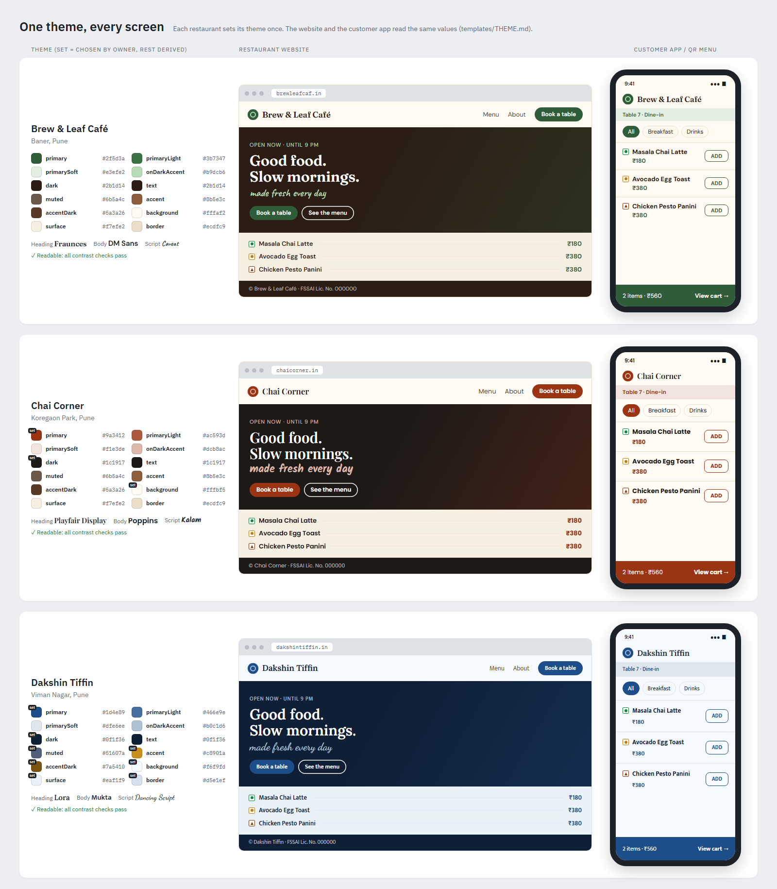

# Restaurant theme spec (v1)

One theme per restaurant brand, set once in the Business panel. The same theme drives every screen:



Regenerate the image with `node theme-preview.mjs > preview.html`, then a headless Chrome screenshot (command at the top of [theme-preview.mjs](theme-preview.mjs)).

Who reads it:

| Reader | How it uses the theme |
|---|---|
| Restaurant website (`templates/*`) | `build.mjs` reads `theme` from the restaurant's data and writes the CSS variables into every page |
| Customer app (`apps/customer`) | Fetches the theme for the restaurant it opened and sets the same CSS variables at runtime |
| Database (`supabase/`) | Stores it per tenant as JSON and rejects invalid values |
| Business panel theme editor | Edits it, with a live preview and readability warnings |

Reference code: [theme.mjs](theme.mjs) (no dependencies, works in Node and the browser):
`validateTheme`, `resolveTheme`, `themeVars`, `themeCss`, `themeWarnings`, `fontsHref`.
JSON Schema for storage and API checks: [theme.schema.json](theme.schema.json).

**Copies to keep in sync** when `theme.mjs` changes:
- `apps/customer/src/app/core/theme/theme.ts` (TypeScript mirror, with a Vitest test that the default theme matches this spec)

Owner of this spec: restaurant-app-53 (templates). **Changing a key, a default or a variable name? Tell the owners of `apps/customer` (ea) and `supabase/` (0f) first.**

---

## Shape

```json
{
  "version": 1,
  "logo": "https://cdn.example/brew-and-leaf/logo.png",
  "colors": {
    "primary": "#2f5d3a",
    "dark": "#2b1d14",
    "background": "#fffaf2"
  },
  "fonts": { "heading": "Fraunces", "body": "DM Sans", "script": "Caveat" }
}
```

Every key is optional for readers: missing keys take the defaults below. The Business panel
always saves `colors.primary`, `colors.dark` and `colors.background`. No other top-level keys.

### `colors`: 6-digit hex (`#rrggbb`), nothing else

| Key | Used for | Default | If missing |
|---|---|---|---|
| `primary` | Buttons, links, prices, brand mark, green sections | `#2f5d3a` | default |
| `primaryLight` | Hover states, decorative icons | `#3b7347` | mix: 82% primary + white |
| `primarySoft` | Soft badges, tag backgrounds | `#e3efe2` | mix: 14% primary + white |
| `onDarkAccent` | Eyebrows and accents on dark/primary backgrounds | `#b9dcb6` | mix: 35% primary + white |
| `dark` | Footer, announcement bar, image overlays, shadows | `#2b1d14` | default |
| `text` | Body text | `#2b1d14` | = `dark` if `dark` is given, else default |
| `muted` | Secondary text | `#6b5a4c` | default |
| `accent` | Secondary brand colour | `#8b5e3c` | default |
| `accentDark` | Nav links, secondary headings | `#5a3a26` | default |
| `background` | Page background | `#fffaf2` | default |
| `surface` | Alternate section background | `#f7efe2` | default |
| `border` | Borders, dividers, chip outlines | `#ecdfc9` | default |

The three mixed shades are derived only when `primary` differs from the default; with the
default primary the hand-picked defaults above are kept. Mixing is plain sRGB, the same as
CSS `color-mix(in srgb, <primary> N%, #fff)`. `resolveTheme()` returns the result as hex,
so readers that can't use `color-mix` (older phone webviews) get identical colours.

### `fonts`: Google Fonts family names

| Key | Used for | Default |
|---|---|---|
| `heading` | Headings, brand name | `Fraunces` |
| `body` | Everything else | `DM Sans` |
| `script` | Handwritten accent lines | `Caveat` |

Any Google Fonts family name is valid (letters, digits, spaces, 2-40 characters). The editor
offers this list, with weights known to exist (Google rejects the whole stylesheet request
if you ask for a weight a font lacks):

- heading: Fraunces, Playfair Display, Lora, DM Serif Display, Yeseva One, Rozha One, Poppins, Montserrat
- body: DM Sans, Inter, Poppins, Nunito, Lato, Mukta, Hind
- script: Caveat, Kalam, Dancing Script, Pacifico

Use `fontsHref(theme)` to build the stylesheet URL; fonts outside the list load at their
default weight. All 19 listed fonts were checked against Google Fonts (HTTP 200) on 2026-10-10.

### `logo`

`null` (a generic icon is shown) or an `https://` URL / relative path ending in `.png` or
`.webp` (no SVG: it can carry script). Max 2 MB. Square, at least 192×192. The website also uses it as the favicon.

---

## CSS variables (the contract between readers)

`themeVars(theme)` / `themeCss(theme)` produce exactly these. Each reader uses these names,
or maps its own internal names onto them (the Modern Café template maps `--green-700` to
`var(--color-primary)` and so on, in `modern-cafe/build.mjs`).

```
--color-primary        --color-dark           --color-accent         --color-background
--color-primary-light  --color-text           --color-accent-dark    --color-surface
--color-primary-soft   --color-muted                                 --color-border
--color-on-dark-accent
--font-heading         --font-body            --font-script
```

Font variables include fallbacks, e.g. `--font-heading: "Fraunces", Georgia, serif`.

## Readability warnings (editor only, never block saving)

`themeWarnings(theme)` flags: white text on `primary` below 4.5:1 contrast, `text` on
`background` below 4.5:1, and `onDarkAccent` on `dark` below 3:1.

## Storage (for `supabase/`)

- One theme per **tenant (brand)**, not per outlet: a chain's outlets share one look.
- Store the theme as the user saved it (`jsonb`), not the resolved version, so later default
  improvements reach restaurants that never changed those keys.
- Check it with `theme.schema.json` (or `validateTheme`) in the API before writing.
- Logos go to Supabase Storage; `logo` holds the public URL.
- `version` lets a future v2 change the shape; readers reject versions they don't know.

Agreed plan (restaurant-app-0f, Phase 8 unless pulled forward):
- Table `public.tenant_themes (tenant_id pk → tenants, theme jsonb, updated_at)`. RLS: owners/admins write, members read.
- Public read: security-definer RPC `get_theme(p_slug)` granted to `anon`, returning only the theme of an active or trial tenant.
- API: `PUT /platform/v1/tenants/:id/theme` (validates against `theme.schema.json`), public `GET /public/v1/restaurants/:slug/theme`.
- Logos: storage bucket `brand-assets` at `<tenant_id>/…`, public read. PNG/WebP only, 2 MB limit (agreed with 0f).
